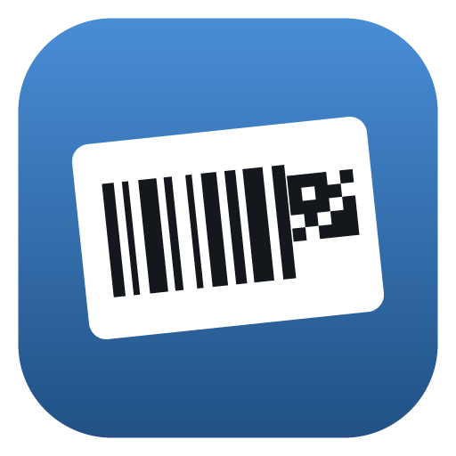
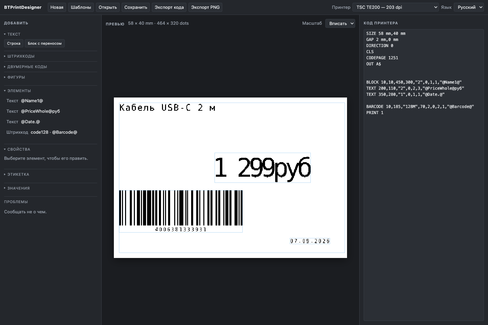
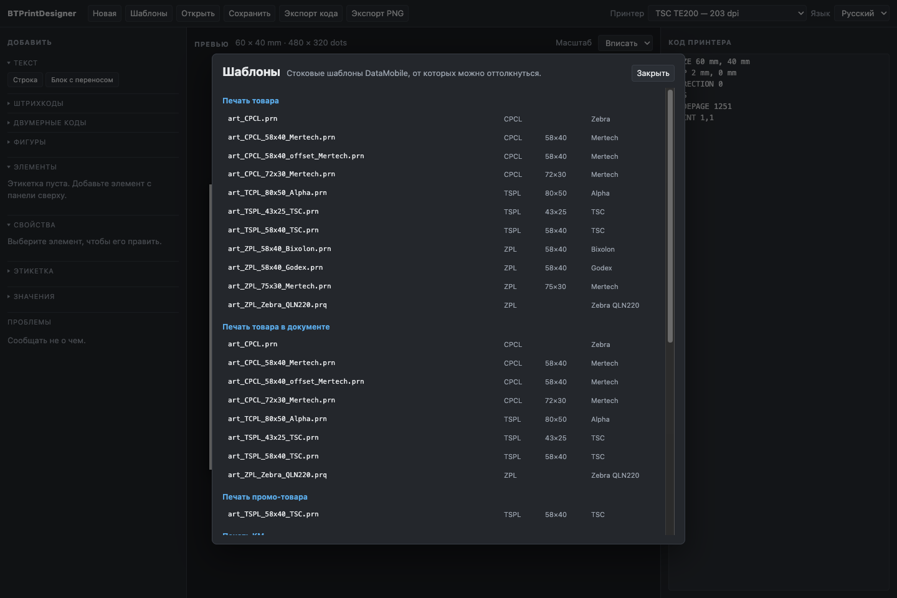

<div align="center">
  
  <h1>BTPrintDesigner</h1>
  <p><strong>От макета этикетки — к командам термопринтера.</strong><br>Визуальный редактор, код и чёрно-белое превью в одном окне.</p>
  <p><a href="https://github.com/qqrxxz/BTPrintDesigner/releases/latest">Скачать portable</a> · <a href="#возможности">Возможности</a> · <a href="#быстрый-старт">Быстрый старт</a> · <a href="#сборка-из-исходников">Сборка</a></p>
  <p><strong>macOS · Windows &nbsp; / &nbsp; TSPL · ZPL · CPCL &nbsp; / &nbsp; Русский · English</strong></p>
</div>



BTPrintDesigner помогает создавать и редактировать этикетки для термопринтеров, готовить шаблоны DataMobile и разбирать готовые файлы команд. Работает локально: для редактирования и превью не нужен облачный сервис.

Превью проходит ту же цепочку, что и экспорт: **макет → команды принтера → 1-битное изображение**. Для шаблонных переменных в превью используются примерные значения; экспорт сохраняет имена переменных для DataMobile.

## Скачать

Готовые файлы доступны в [GitHub Releases](https://github.com/qqrxxz/BTPrintDesigner/releases/latest).

| Система | Файл | Как запустить |
| --- | --- | --- |
| Mac с Apple Silicon (M1 и новее) | `BTPrintDesigner-0.0.1-mac-arm64.zip` | Распаковать и открыть `BTPrintDesigner.app` |
| Mac с процессором Intel | `BTPrintDesigner-0.0.1-mac-x64.zip` | Распаковать и открыть `BTPrintDesigner.app` |
| Windows x64 / ARM64 | `BTPrintDesigner-0.0.1-portable.exe` | Запустить EXE без установки |

На Mac приложение можно хранить в удобной папке или перенести в «Программы». Windows-версия распаковывает компоненты во временную папку при запуске. Portable означает запуск без установщика; настройки интерфейса могут сохраняться в пользовательском профиле.

Сборки не подписаны коммерческим сертификатом. macOS-версия имеет локальную ad-hoc подпись, но не нотарификацию Apple. При первом запуске система может запросить разрешение в «Системные настройки → Конфиденциальность и безопасность». Windows может показать SmartScreen. Разрешайте запуск только для сборки из доверенного источника; контрольные суммы приложены к релизу.

## Возможности

| Задача | Что есть в приложении |
| --- | --- |
| Собрать этикетку | Текст, блоки с переносом, линии, рамки, фигуры и коды |
| Настроить геометрию | Размеры в миллиметрах, перемещение мышью, изменение размеров и точные числовые поля |
| Добавить штрихкод | Code 128, GS1-128, EAN, Code 39, ITF |
| Добавить двумерный код | QR, Data Matrix, GS1 DataMatrix, PDF417 |
| Выбрать принтер | Профили TSC и Zebra, разрешения 203 / 300 / 600 dpi |
| Редактировать готовый файл | Импорт TSPL, ZPL и CPCL, определение языка по содержимому |
| Подготовить DataMobile | Встроенные шаблоны, выбор переменных по операции, значения для предпросмотра |
| Сохранить результат | Проект `.btpd.json`, команды принтера, изображение PNG |
| Работать с кириллицей | UTF-8 и Windows-1251, настройка кодировки экспорта |
| Проверить макет | Диагностика команд и ограничений, привязка сообщений к исходному коду |

Набор доступных команд зависит от языка принтера. Приложение сообщает о неподдерживаемых возможностях при генерации.

## Быстрый старт

1. Выберите профиль принтера в верхней панели — он задаёт язык команд и DPI.
2. Откройте **Шаблоны** или создайте новую этикетку и задайте её размеры.
3. Добавьте текст, штрихкод или фигуру. Перемещайте элементы на макете и уточняйте размеры в свойствах.
4. Для DataMobile выберите операцию и переменные. В разделе **Значения** задайте данные для превью.
5. Сохраните проект для дальнейшего редактирования. Нажмите **Экспорт кода** для получения файла принтера или **Экспорт PNG** для изображения.

Экспортированный файл передаётся в DataMobile или другое ПО печати. Приложение занимается подготовкой макета и команд; подключение к Bluetooth-принтеру и отправка задания не входят в этот процесс.

## Примеры работы

### Ценник из шаблона DataMobile

Откройте `art_TSPL_58x40_TSC.prn`: получите этикетку 58 × 40 мм с названием товара, ценой, датой и Code 128. Измените расположение элементов под свой носитель. В коде сохранятся `@Name1@`, `@PriceWhole@`, `@Date.@` и `@Barcode@`, а превью покажет эти поля с примерными значениями.



### GS1 DataMatrix для TSPL

Добавьте **GS1 DataMatrix**, задайте данные и выберите используемый токен разделителя: `~1`, `_1`, `~d029`, `~]` или без замены. Размер символа рассчитывается по данным и ширине модуля.

Генератор по умолчанию добавляет `c126` в команду `DMATRIX`. Структура команды:

```text
DMATRIX x,y,width,height,c126,"данные"
```

В экспортируемом шаблоне токен разделителя остаётся как введён; для превью он заменяется символом разделителя. Корректность данных GS1 и поведение конкретной прошивки стоит проверить пробной печатью и сканированием.

### От готового кода к макету

Откройте `.prn`, `.prq`, `.lbl` или текстовый файл: программа определит язык по содержимому и построит превью. Если все команды представимы в модели, элементы можно редактировать визуально. Если часть команд не поддерживается моделью, исходный код остаётся главным, а интерфейс объясняет, какие строки препятствуют визуальному редактированию.

### Точная подгонка

Стрелки перемещают выделенный элемент на **0,1 мм**, `Shift` + стрелки — на **1 мм**. Изменение профиля принтера пересчитывает размеры в точках с учётом DPI. Масштаб превью помогает рассмотреть отдельные точки и тонкие линии.

## Как устроено превью

```text
Макет в миллиметрах ──→ генератор TSPL / ZPL / CPCL
                                  │
Готовый файл команд ───────────────┤
                                  ▼
                         интерпретатор команд
                                  │
                                  ▼
                         1-битное изображение
```

Превью помогает обнаружить ошибки до печати, но не заменяет проверку на оборудовании. Встроенные шрифты принтеров заменены DejaVu; их начертание может отличаться. Команды изображений TSPL `BITMAP`, `PUTBMP`, `PUTPCX` распознаются, но не отрисовываются. Размеры шрифтов CPCL могут отличаться между семействами принтеров. Неподдерживаемые команды выводятся в диагностике.

## Сборка из исходников

Нужен Node.js 20 или новее и npm. Команды выполняются из корня репозитория.

```bash
npm ci
npm run build
npm run start --workspace=@btpd/app
```

Для разработки:

```bash
npm run dev --workspace=@btpd/app
```

Проверки:

```bash
npm test
npm run typecheck
```

Portable-сборки:

```bash
npm run dist:mac   # ZIP с .app: Apple Silicon и Intel
npm run dist:win   # Один portable EXE: Windows x64 и ARM64
```

Результаты появляются в `packages/app/release/`. Ядро собирается перед интерфейсом, поэтому в приложение попадают актуальные генераторы и рендереры. Для macOS-сборки нужен Mac с инструментом `codesign`; для кросс-сборки Windows на Mac нужен Wine. Electron и инструменты упаковки могут загружаться при первой сборке.

## Структура проекта

| Каталог | Назначение |
| --- | --- |
| [`packages/app`](packages/app) | Electron, интерфейс, файловые операции, встроенные шаблоны |
| [`packages/core`](packages/core) | Модель этикетки, генераторы, импорт, интерпретаторы, штрихкоды и растр |
| [`docs/screenshots`](docs/screenshots) | Реальные снимки интерфейса для документации |

Подробнее: [интерфейс и поведение редактора](packages/app/README.md) · [устройство ядра](packages/core/README.md).

Шрифты DejaVu поставляются со своей [лицензией](packages/core/assets/fonts/LICENSE-DejaVu.txt).
